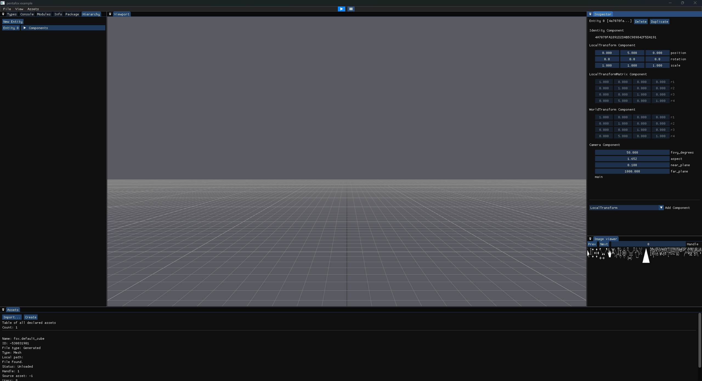
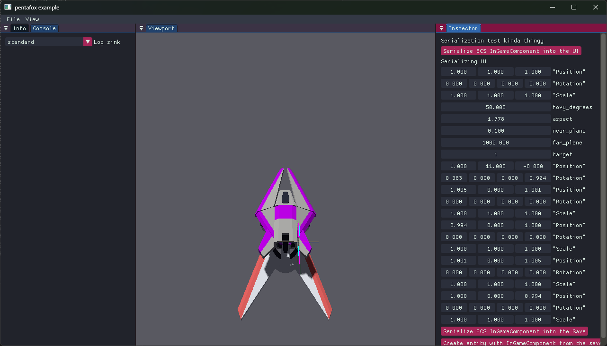
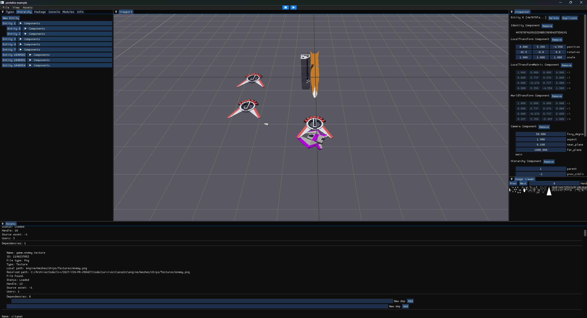
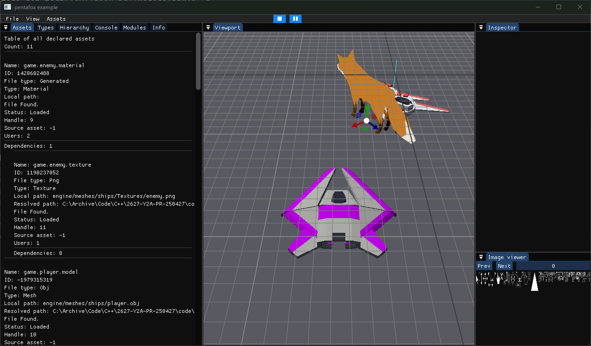

## Gallery








Unfortunately, I cannot share the project or make github page public, as well as share some code, due to an NDA.

## General overview

Pentafox Engine was written from scratch, based on a close-source XSR (extra small renderer) written by Bojan. It supports:
- Windows and Play Station 5 platforms
- basic rendering
- platform-specific input (keyboard/mouse vs controller)
- dynamic asset management
- OBJ/GLTF/image loading
- asset cooking
- DLL management
- hot DLL reload
- runtime reflection
- serialization (saving, loading, GUI)
- packaging script for windows
- basic hierarchy support
- ECS
- logging with sinks

## Technical detailed overiew

Simplest game can be as simple as this:

```cpp
#include <pentafox/api.hpp>

class MyGame : public fox::IGame
{
public:
    void init() override
    {
    }

    void update() override
    {
    }
};

FOX_REGISTER_GAME(MyGame)
``` 