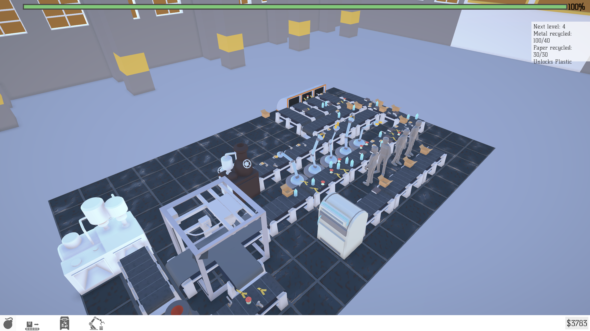
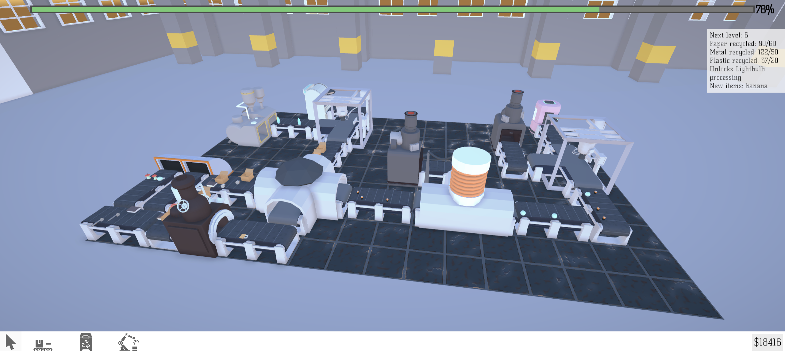
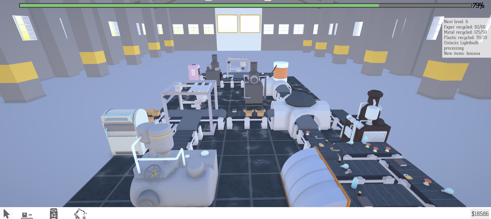
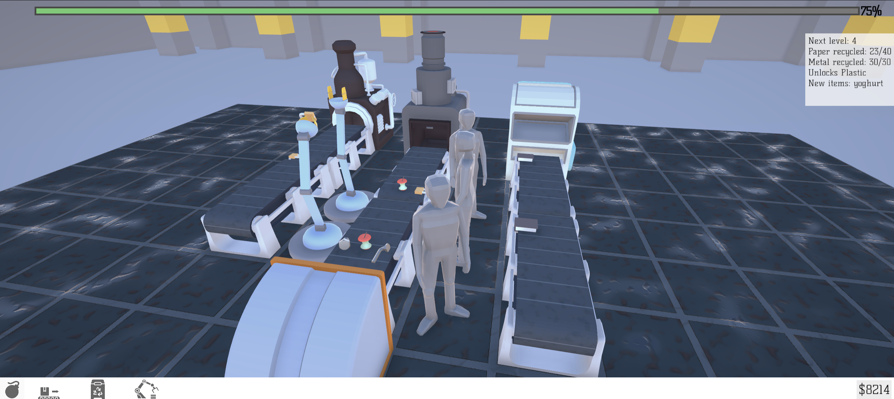
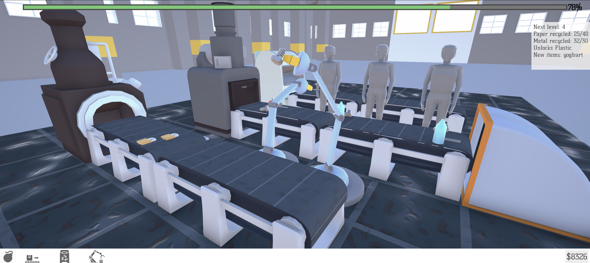



Project I made for Saxion University as an intake - I passed, but decided to go to BUAS.
The game is about automating and managing a recycling facility. You install "trash generators" which output trash on the adjacent conveyor, which you then can sort, incinerate or recycle in a special machine - e.g. plastic in a plastic recycler. At some point of progression there is no machine to sort out specific items - like batteries or light bulbs - machines you have can sort items by specific properties, like weight, transparency and metallicness.

